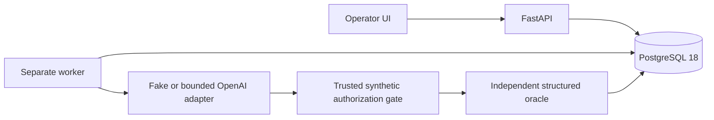

# Architecture and decisions

One Python package/image serves a FastAPI API and a separate worker. PostgreSQL 18
holds workspace ownership, immutable inputs, queued jobs, fenced leases, results,
reservations and demo admission quotas. SQLAlchemy async/psycopg and Alembic manage
persistence. Jinja/vanilla JS renders the operator UI; bearer tokens stay in memory.

The diagram is a logical flow, not permission delegation: model output never sets
actor/workspace authority. Worker supplies scenario identity; token authentication
supplies workspace. Each attempt starts fresh synthetic state. Expected constraints
stay out of provider messages. Integer minor units never represent real payments.
No arbitrary provider endpoints or executable dataset imports exist.

Four decision records: [package](adr/0001-package.md),
[queue/budget](adr/0002-queue.md), [evaluation](adr/0003-evaluation.md),
[public-demo threat model](threat-model.md). Operational risks and recovery caveats
are in [operations](operations.md); telemetry is in [observability](observability.md).
